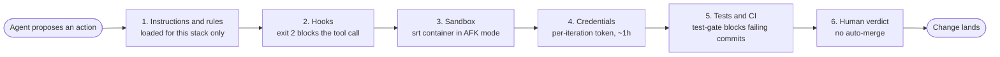
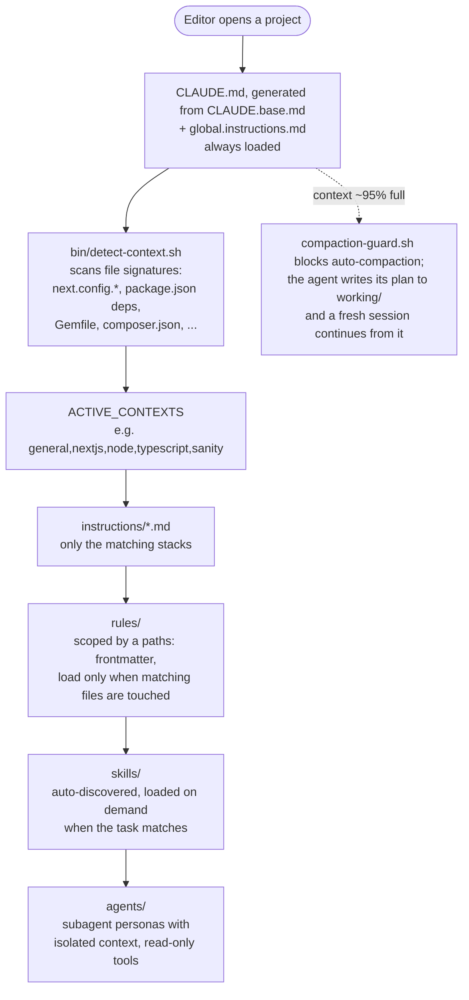
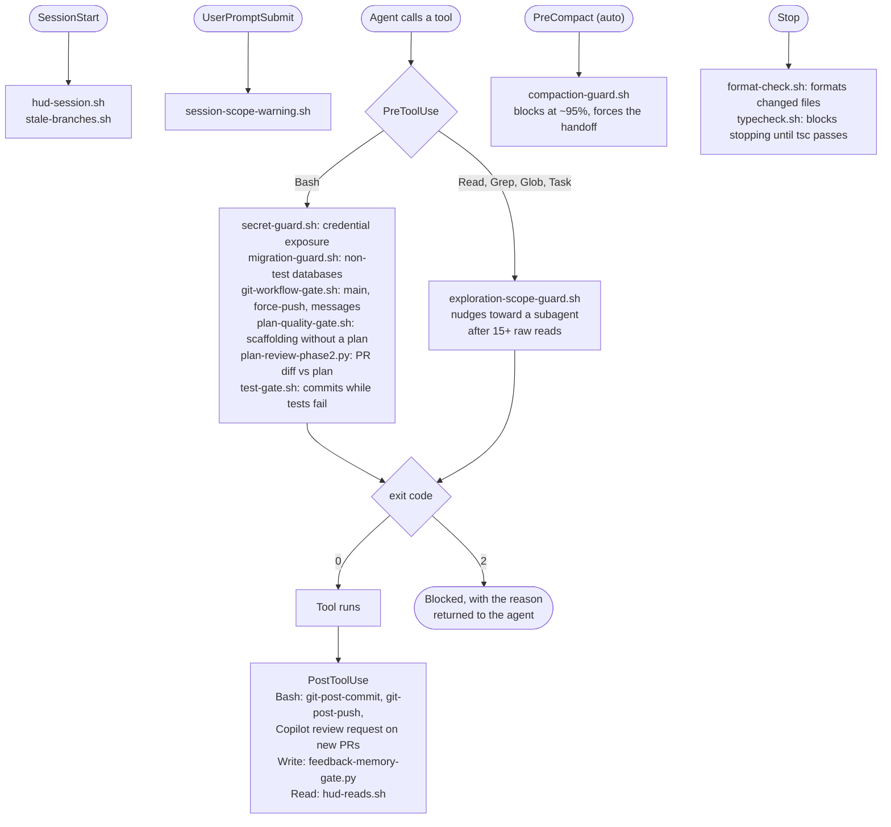
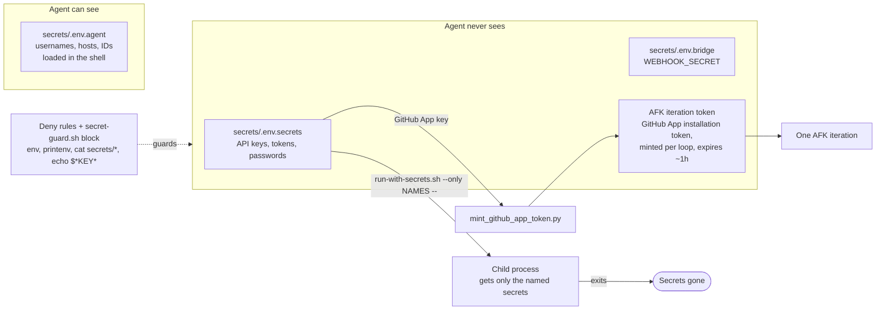
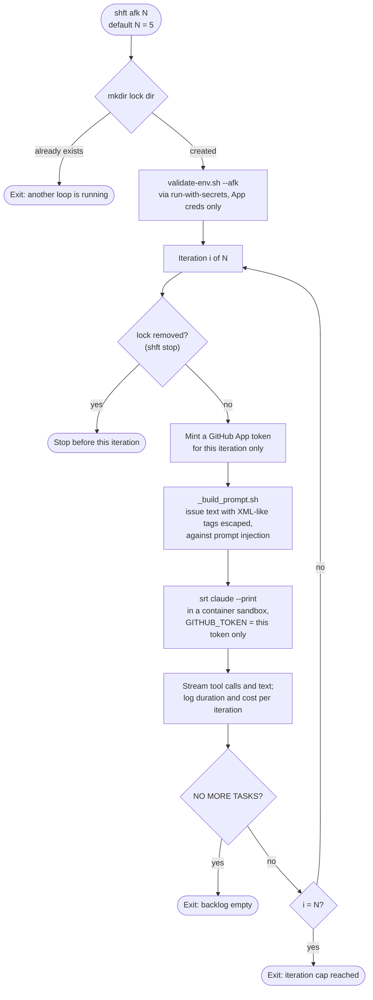
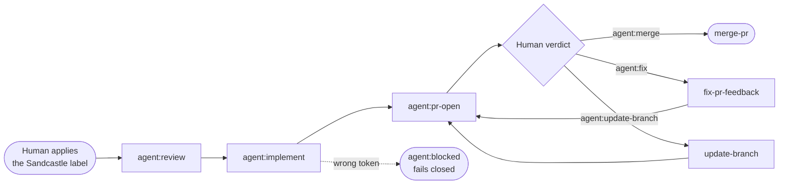

# System diagrams

How ctrl+shft keeps coding agents consistent, safe and observable, in six diagrams. Each one links to the files that implement it. For the folder-level map, see [ARCHITECTURE.md](ARCHITECTURE.md). For the planning pipeline and the Sandcastle label workflow, see the [README](../README.md).

1. [Defense in depth](#1-defense-in-depth): what stands between an agent and a bad change
2. [Context loading](#2-context-loading): only the rules that match the project
3. [Guardrail hooks](#3-guardrail-hooks): which hook fires on which event
4. [Secrets](#4-secrets): config the agent can see, credentials it never can
5. [The AFK loop](#5-the-afk-loop): one iteration, start to finish
6. [Sandcastle](#6-sandcastle): the same loop in GitHub Actions, with two human gates

---

## 1. Defense in depth

No single layer is trusted on its own. Instructions shape what the agent tries; hooks block what it shouldn't do; the sandbox and short-lived tokens limit what a mistake can reach; tests and a human decide what merges.

| Layer | Files |
|---|---|
| Instructions and rules | [`global.instructions.md`](../global.instructions.md), [`instructions/`](../instructions/), [`rules/`](../rules/), [`bin/detect-context.sh`](../bin/detect-context.sh) |
| Hooks | [`hooks/`](../hooks/), registered in [`hooks/settings-hooks.json`](../hooks/settings-hooks.json) |
| Sandbox | [`shft/afk.sh`](../shft/afk.sh) runs `srt claude` |
| Credentials | [`bin/run-with-secrets.sh`](../bin/run-with-secrets.sh), [`bin/mint_github_app_token.py`](../bin/mint_github_app_token.py), [`secrets/README.md`](../secrets/README.md) |
| Tests and CI | [`hooks/test-gate.sh`](../hooks/test-gate.sh), [`test/hooks/`](../test/hooks/) |
| Human verdict | Sandcastle's verdict labels, section 6 |

---

## 2. Context loading

Every session starts with the same small global file. Everything else loads only when it applies, which keeps unrelated rules out of the context window and cuts the tokens spent on them.

Files: [`bin/detect-context.sh`](../bin/detect-context.sh), [`instructions/README.md`](../instructions/README.md), [`rules/`](../rules/), [`skills/`](../skills/), [`agents/`](../agents/), [`hooks/compaction-guard.sh`](../hooks/compaction-guard.sh).

---

## 3. Guardrail hooks

Claude Code runs these scripts at fixed points in a session. A `PreToolUse` hook that exits with code 2 blocks the tool call; exit 0 allows it. The registrations below are from [`hooks/settings-hooks.json`](../hooks/settings-hooks.json).

The guard hooks have regression tests in [`test/hooks/`](../test/hooks/): `secret-guard`, `migration-guard`, `git-workflow-gate`, `test-gate`, `exploration-scope-guard` and others, run by `run-hook-tests.sh`. Details and customization: [`hooks/README.md`](../hooks/README.md).

---

## 4. Secrets

Four tiers. The agent can read config, never credentials. A credential exists only inside the child process that needs it and is gone when that process exits.

Files: [`secrets/README.md`](../secrets/README.md), [`bin/run-with-secrets.sh`](../bin/run-with-secrets.sh), [`bin/mint_github_app_token.py`](../bin/mint_github_app_token.py), [`hooks/secret-guard.sh`](../hooks/secret-guard.sh). If a raw token is ever printed, the README's rotation steps apply.

---

## 5. The AFK loop

`shft afk` works through the GitHub issue backlog with nobody watching. Each iteration gets its own token, its own sandbox run and its own log, and the loop stops at a fixed number of iterations or when the backlog is empty.

Files: [`shft/afk.sh`](../shft/afk.sh), [`shft/_build_prompt.sh`](../shft/_build_prompt.sh), [`shft/README.md`](../shft/README.md).

One known gap: on WSL and MSYS there's no container sandbox, so the loop runs Claude directly and prints a warning. The hooks and deny rules still apply, but there's no second layer.

---

## 6. Sandcastle

Sandcastle runs the same loop in GitHub Actions, driven by labels on issues and PRs. The engine lives once in [`ctrlshft-hub`](https://github.com/arndvs/ctrlshft-hub); each consumer repo keeps a config file, a SHA-locked hub version, and thin workflow stubs.

Two human gates by design: the start gate (applying the label) and the verdict gate. There is no auto-merge. Agent output is validated against schemas, and label chaining needs `AGENT_PAT`; with the wrong token the chain fails closed into `agent:blocked`. Details: the [Sandcastle section of the README](../README.md#sandcastle-autonomous-agents-in-ci) and [ADR-005](adr/ADR-005-sandcastle-agent-parity.md).
